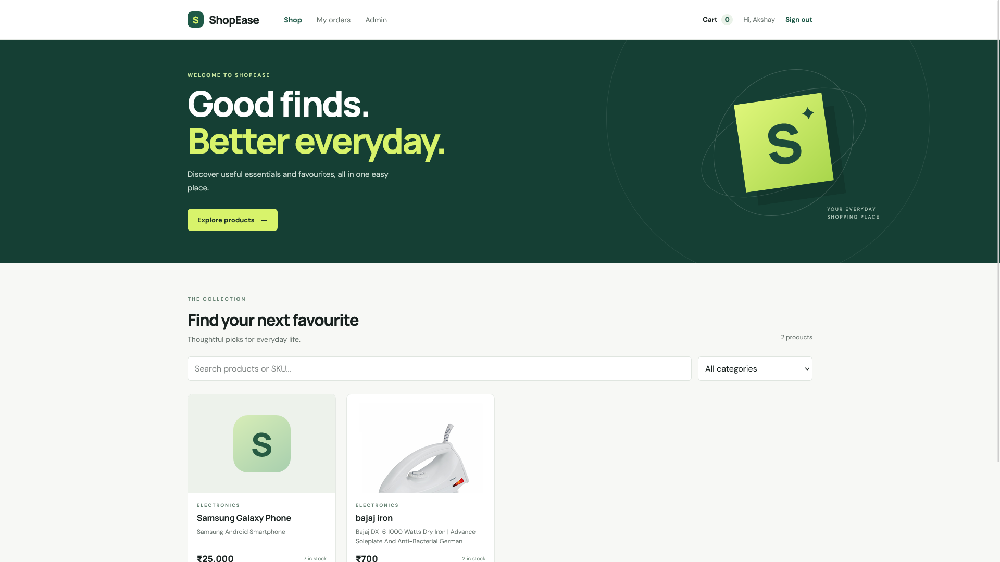
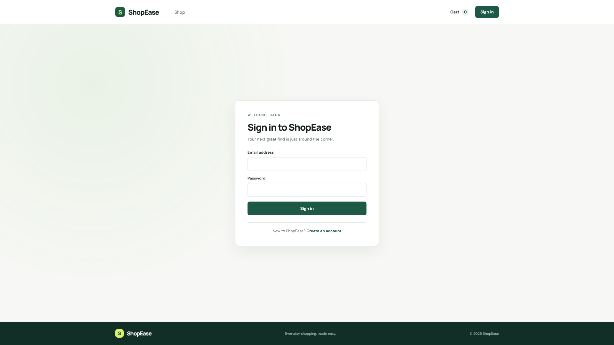
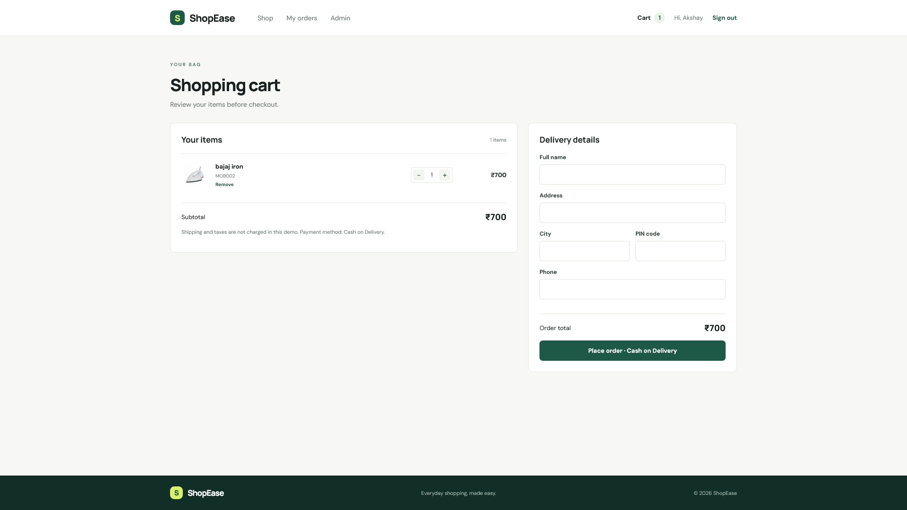
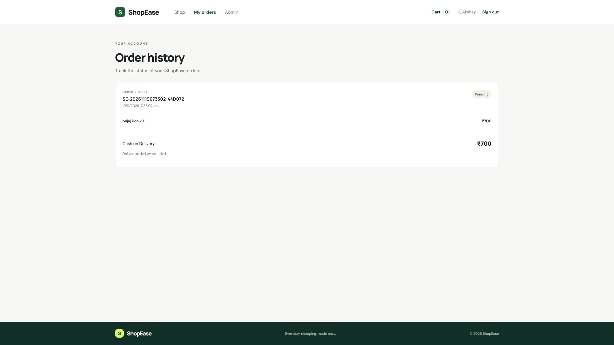
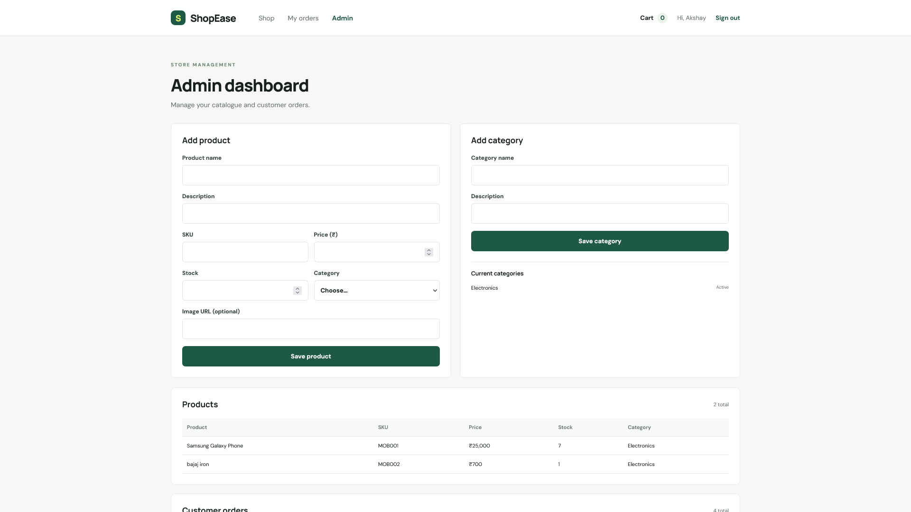

# ShopEase — Full-stack E-commerce MVP

This package contains the .NET 10 Web API, SQL Server/EF Core backend, and React + Vite frontend. The original source files from the uploaded archive have been placed back into the project paths expected by `ShopEase.slnx` and the project references.

## Included features

### Customer
- Register and sign in (JWT)
- Browse/search products and filter by category
- Add/update/remove cart items
- Cash on Delivery checkout
- View order history and order details

### Admin
- Admin-only dashboard
- Manage products and categories
- View customer orders
- Change order status

### Backend
- ASP.NET Core Web API targeting .NET 10
- SQL Server with Entity Framework Core migrations
- Password hashing, JWT authentication and role-based authorization
- Initial Admin account provisioning from .NET User Secrets

## Requirements
- Windows 10/11
- .NET 10 SDK
- SQL Server Express (or another SQL Server instance)
- Node.js 20+ and npm

## 1. Configure the database connection

Edit `src/backend/ShopEase.Api/appsettings.Development.json` if your SQL Server instance differs from `localhost\\SQLEXPRESS`. The default database name is `ShopEaseDB` and Windows Authentication is configured for local development.

## 2. Configure secrets (PowerShell)

Run from the project root. These values are stored in .NET User Secrets, not in the project files. Use a unique strong Admin password of at least 14 characters. Do not share or commit secrets.

```powershell
$api = ".\src\backend\ShopEase.Api\ShopEase.Api.csproj"
$bytes = New-Object byte[] 48
[Security.Cryptography.RandomNumberGenerator]::Create().GetBytes($bytes)
$jwtKey = [Convert]::ToBase64String($bytes)
dotnet user-secrets init --project $api
dotnet user-secrets set "Jwt:Key" $jwtKey --project $api
dotnet user-secrets set "Admin:Email" "admin@shopease.local" --project $api
dotnet user-secrets set "Admin:FullName" "ShopEase Admin" --project $api
$secure = Read-Host "Enter a unique Admin password (minimum 14 characters)" -AsSecureString
$ptr = [Runtime.InteropServices.Marshal]::SecureStringToBSTR($secure)
try { $adminPassword = [Runtime.InteropServices.Marshal]::PtrToStringBSTR($ptr) } finally { [Runtime.InteropServices.Marshal]::ZeroFreeBSTR($ptr) }
dotnet user-secrets set "Admin:Password" $adminPassword --project $api
Remove-Variable adminPassword, jwtKey, bytes, secure, ptr
```

If your existing project already has User Secrets configured, keep using those same values. The seed code creates the Admin only if the configured email does not already exist. It will not promote a Customer account to Admin.

## 3. Restore and apply database migrations

The ZIP already includes both migrations (`InitialCreate` and `AddCommerceModules`). Do **not** create another migration for these same changes.

```powershell
$env:ASPNETCORE_ENVIRONMENT = "Development"
dotnet restore .\ShopEase.slnx
dotnet tool install --global dotnet-ef --version 10.0.0
dotnet ef database update --project .\src\backend\ShopEase.Infrastructure\ShopEase.Infrastructure.csproj --startup-project .\src\backend\ShopEase.Api\ShopEase.Api.csproj
```

If `dotnet-ef` is already installed, use `dotnet tool update --global dotnet-ef --version 10.0.0` instead of the install command. The database update applies the migrations to the configured database; it does not require deleting your existing database.

## 4. Run the backend

In PowerShell at the project root:

```powershell
dotnet run --project .\src\backend\ShopEase.Api\ShopEase.Api.csproj
```

The configured HTTP address is `http://localhost:5157`. Keep this terminal open. OpenAPI is exposed in Development.

## 5. Run the frontend

Open a second PowerShell window:

```powershell
cd .\src\frontend
Copy-Item .env.example .env
npm install
npm run dev
```

Open `http://localhost:5173`. The frontend calls `http://localhost:5157/api` by default. If you change the API address, update `VITE_API_URL` in `.env` and the allowed frontend origin in the API configuration.

## Project layout

```text
ShopEase-Complete-MVP/
├── ShopEase.slnx
├── README.md
├── scripts/
│   └── Setup-Database.ps1
└── src/
    ├── backend/
    │   ├── ShopEase.Api/
    │   ├── ShopEase.Application/
    │   ├── ShopEase.Domain/
    │   └── ShopEase.Infrastructure/
    └── frontend/
        ├── src/
        ├── index.html
        ├── package.json
        └── vite.config.js
```

## Application Screenshots

### Home Page


### Login


### Shopping Cart


### Checkout


### My Orders


### Admin Dashboard


## Important

This project has been built and run locally on Windows. The .NET backend and React frontend builds succeeded, and the database migrations were applied successfully. Manually tested workflows include customer registration and login, product browsing, cart operations, Cash on Delivery checkout, order history, Admin login and dashboard, and order status updates. This is a portfolio MVP, not a production-ready commerce platform. It does not currently integrate a real payment gateway.
